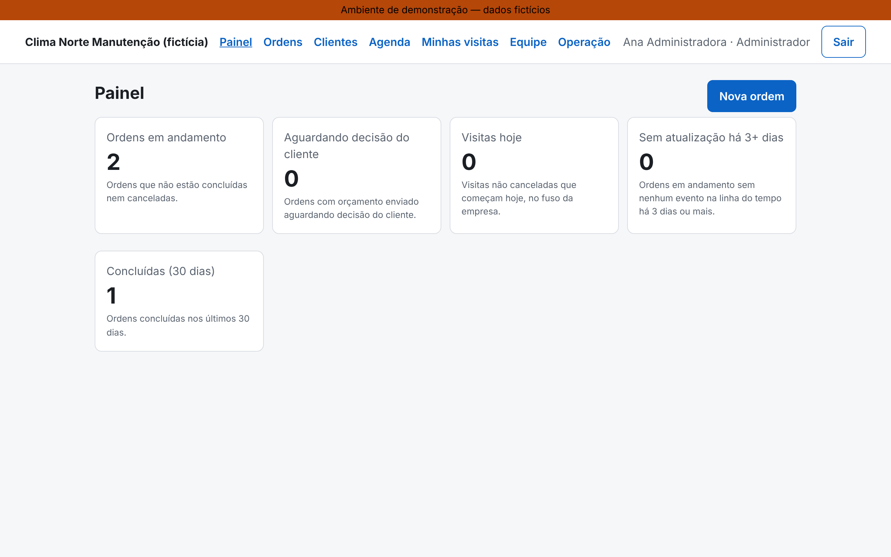
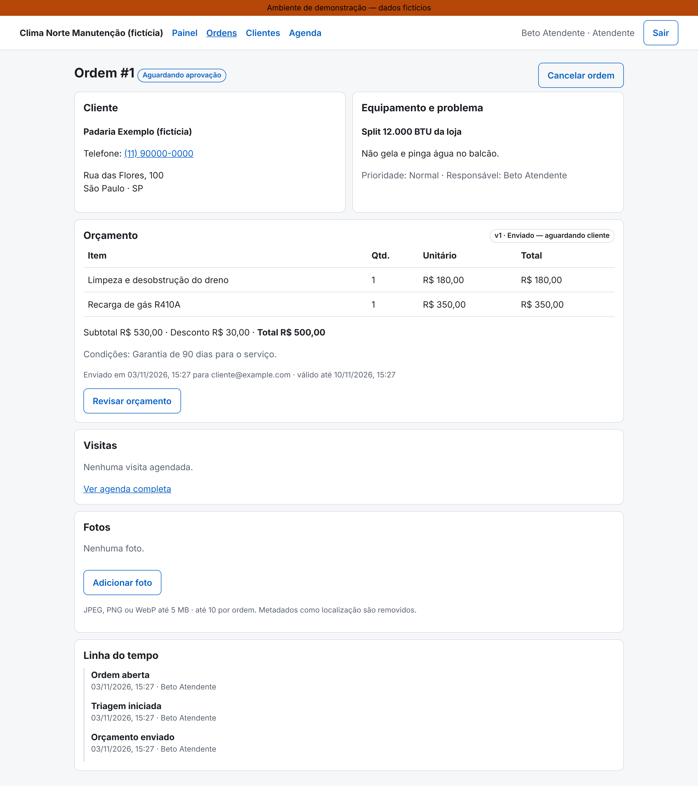
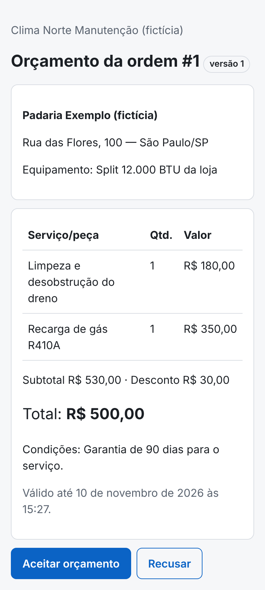
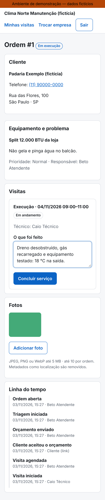

# ServiçoFlow

Sistema web para pequenas empresas de manutenção de ar-condicionado acompanharem
**pedido → orçamento → visita → execução** em um só lugar.

- O **atendente** registra o pedido, monta o orçamento e agenda visitas sem conflito de horário.
- O **cliente** abre um link privado, vê uma versão específica do orçamento e aceita ou recusa, sem criar conta.
- O **técnico** vê as visitas no celular, registra o que fez e envia fotos.

> **Estado atual (2026-11-03): demonstração técnica, verificada localmente.**
> A jornada completa funciona com persistência real (PostgreSQL) e está coberta por testes.
> **Não é hospedado** (decisão: projeto de portfólio). As imagens Docker são publicadas no GHCR pelo CI,
> depois de um smoke test. Não há empresa parceira:
> entrevistas, empresas, clientes e orçamento de infraestrutura são **fictícios**.

## Experimente em 1 minuto (Docker)

```bash
docker compose -f infra/demo/docker-compose.yml up -d
```

Abra http://localhost:8080 e entre com `beto@clima-norte.example.com` / `demo-senha-123` (atendente fictício).
Os e-mails de convite e orçamento chegam em http://localhost:8025 (Mailpit). Essa demo usa as imagens
publicadas em `ghcr.io/italo-afr/servicoflow-*` e é verificada no CI a cada push (login, convite e
e-mail entregue). Para zerar os dados:

```bash
docker compose -f infra/demo/docker-compose.yml down -v
```

## Telas (dados fictícios)

| Painel                                    | Ordem com orçamento                                   | Cliente decide (celular)                                      | Técnico executa (celular)                                    |
| ----------------------------------------- | ----------------------------------------------------- | ------------------------------------------------------------- | ------------------------------------------------------------ |
|  |  |  |  |

Mais em [`docs/screenshots/`](docs/screenshots/).

## Problema (hipótese, não validada)

Pequenas empresas de manutenção podem perder pedidos, aprovações e histórico ao coordenar
serviços por WhatsApp, telefone e planilhas. Ver [`docs/discovery.md`](docs/discovery.md).

## Jornada principal

```text
Atendente cadastra cliente/local/equipamento → abre ordem (OPEN) → triagem (TRIAGE)
   ↳ visita de diagnóstico opcional (técnico registra achados)
→ envia versão do orçamento (AWAITING_APPROVAL) → e-mail com link privado
→ cliente aceita (APPROVED)        | recusa ou expira → volta à triagem
→ agenda execução sem conflito (SCHEDULED)
→ técnico inicia no celular (IN_PROGRESS) → resumo + fotos → COMPLETED
```

## Decisões de engenharia (todas implementadas e testadas localmente)

| Problema                                      | Como foi resolvido                                                                         | Evidência        |
| --------------------------------------------- | ------------------------------------------------------------------------------------------ | ---------------- |
| Dados de uma empresa vazando para outra       | Associação ativa checada a cada requisição; FKs compostas `(organization_id, id)` no banco | T01, T02         |
| Orçamento alterado depois de enviado          | Snapshot imutável + triggers no banco; mudança gera nova versão e revoga o link            | `quotes.test.ts` |
| Clique duplo / duas abas decidindo            | `SELECT … FOR UPDATE`; repetição devolve o recibo sem novos efeitos                        | T06, T07, T08    |
| Duas visitas sobrepostas para o mesmo técnico | `EXCLUDE USING gist` sobre `tstzrange [início, fim)`, válido entre empresas                | T10–T12          |
| E-mail fora do ar na hora da aprovação        | Outbox na mesma transação; worker com `SKIP LOCKED`, lease, backoff                        | T14, T15         |
| Link de orçamento vazando                     | Token de 256 bits no fragmento `#`, só hash no banco, trocado por cookie curto             | T09              |
| Foto maliciosa ou com GPS                     | Validação pelo conteúdo, reprocessamento WebP sem EXIF, URLs de 5 min                      | T17, T18         |

O teste T08 (revisão concorrente com aceite) encontrou um bug real numa constraint, corrigido
por uma nova migration (`0005`).

## Números medidos (local, dados sintéticos)

- **85** testes de integração contra PostgreSQL real, **28** unitários, **1** E2E da jornada no celular.
- Carga de 120 s com 20 usuários virtuais e 10 mil ordens: **p95 57,6 ms, 0 erros, ~587 req/s**
  (um contêiner de 4 vCPU; não extrapolar).
- Backup e restauração ensaiados: dados e totais idênticos, API sobe no banco restaurado.

- Triagem assistida **sem IA** (regras): **23/30 (76,7%)** nos casos reservados, abaixo do gate de 90% →
  desligada por padrão. A IA não foi lançada: faltou orçamento e o gate não foi atingido (ADR-0010).

Detalhes: [`docs/evidence/`](docs/evidence/) · Estudo de caso: [`docs/case-study.md`](docs/case-study.md).

## Arquitetura

Monólito modular: Next.js (web) + NestJS (API e worker do mesmo código) + PostgreSQL + storage S3 privado.
Web e API na mesma origem atrás do Caddy. Ver [`docs/architecture.md`](docs/architecture.md).

**Stack fixada:** Node 24.22.2 · pnpm 10.28 · TypeScript 5.9 · Next.js 16.4 · NestJS 12.3 · better-auth 1.7 ·
PostgreSQL 16 · `pg` + SQL (sem ORM) · zod 4 · sharp · Vitest 5 · Playwright 1.63.

## Como rodar

Passo a passo em [`docs/setup.md`](docs/setup.md). Resumo:

```bash
pnpm install --frozen-lockfile
```

```bash
cp .env.example .env
```

```bash
pnpm db:migrate && pnpm db:seed && pnpm dev
```

Acesse http://localhost:3000 com `beto@clima-norte.example.com` / `demo-senha-123` (conta fictícia).

## Verificações

```bash
pnpm lint && pnpm typecheck && pnpm test:unit && pnpm test:integration && pnpm test:e2e && pnpm build
```

## Segurança, operação e limites

- [`docs/security.md`](docs/security.md): modelo de ameaças, matriz de papéis e dados pessoais.
- [`docs/runbooks.md`](docs/runbooks.md): 10 procedimentos de incidente.
- [`docs/adr/`](docs/adr/): 10 decisões registradas.
- **Monitoramento:** métricas Prometheus em portas internas e 9 regras de alerta com testes unitários (validadas pelo `promtool` no CI). O worker também tem um avaliador de alertas que envia e-mail mesmo sem Prometheus. Ver ADR-0009.

**Limites conhecidos:**

- O compose de produção e o Caddyfile **nunca foram executados**. As imagens são testadas no CI.
- Não há traces nem dashboards.
- Um e-mail pode ser duplicado se o processo cair logo após o provedor aceitar o envio.
- O limite de taxa das rotas públicas vale para uma instância só.
- O aceite é um registro operacional, não pagamento nem assinatura jurídica.

## Documentação de produto

[`docs/project-brief.md`](docs/project-brief.md) (especificação) · [`docs/product.md`](docs/product.md) ·
[`docs/backlog.md`](docs/backlog.md) · [`docs/progress.md`](docs/progress.md) · [`docs/costs.md`](docs/costs.md) ·
[`docs/case-study.md`](docs/case-study.md) · [`docs/demo-script.md`](docs/demo-script.md) (roteiro do vídeo) ·
[`docs/interview-prep.md`](docs/interview-prep.md)

## Próximos passos

1. Gravar o vídeo seguindo [`docs/demo-script.md`](docs/demo-script.md).
2. Fazer uso acompanhado com uma empresa real, se houver uma disponível: validar H1, H2 e H6.
3. Triagem com IA: só com orçamento aprovado e um dataset 2.0 revisado por um técnico.
