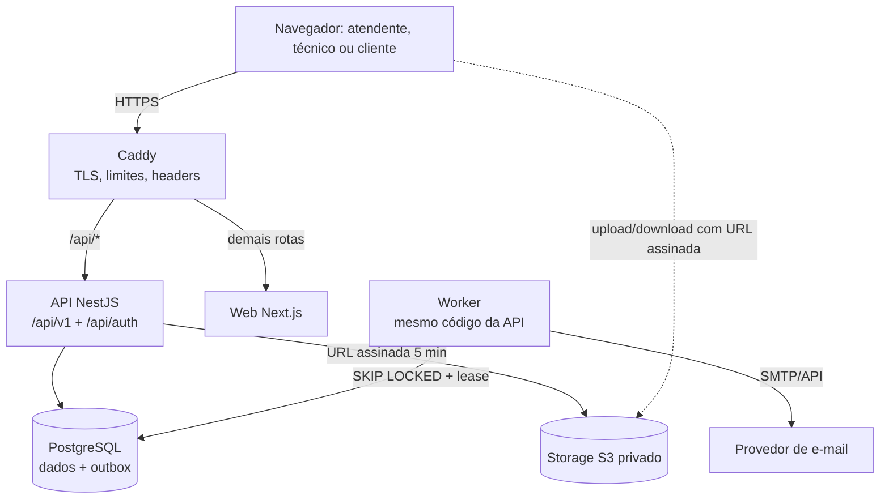
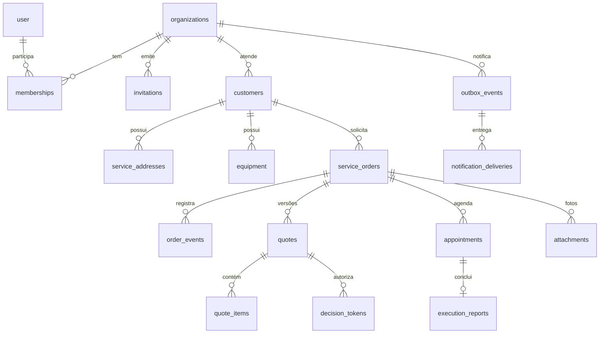

# Arquitetura

Monólito modular (ADR-0001). Web e API na **mesma origem**: o navegador fala só com `/` e `/api`.

Em desenvolvimento, o `next dev` reescreve `/api/*` para `localhost:3001` (mesmo papel do Caddy).

## Caminho de uma requisição (ex.: aceitar orçamento)

1. Navegador → `POST /api/v1/public/quote-access/decision` com cookie `sf_quote` e `Origin`.
2. `RequestIdMiddleware` atribui `requestId` (devolvido em `x-request-id` e no corpo de erros).
3. `AccessGuard`: confere `Origin` (CSRF); rota `@Public` dispensa sessão de usuário.
4. Controller valida o corpo com zod (`confirm: true` obrigatório; campos extras → 422).
5. Transação: `SELECT … FOR UPDATE` no orçamento e no token → validade → transição da ordem (`transitionOrder`) → evento na linha do tempo → auditoria → `enqueue` na outbox → `COMMIT`.
6. Worker, depois: lê o evento, monta o e-mail e envia fora da transação.

## Módulos (`apps/api/src`)

| Módulo          | Responsabilidade                                                         |
| --------------- | ------------------------------------------------------------------------ |
| `identity`      | better-auth, `AccessGuard`, matriz `policy.ts`, decorators de contexto   |
| `organizations` | convites, membros, CLI de criação controlada de empresa                  |
| `customers`     | clientes, locais, equipamentos (arquivamento, sem exclusão)              |
| `orders`        | ordens, máquina de estados (`state.ts`), linha do tempo, hooks           |
| `quotes`        | cálculo (`money.ts`), versões, envio, revisão, acesso público, expiração |
| `scheduling`    | visitas, constraint de exclusão, início/conclusão, relatórios            |
| `attachments`   | storage S3/local, validação de imagens                                   |
| `notifications` | outbox, mailer, templates, processador do worker                         |
| `ops`           | painel de indicadores e da fila                                          |
| `worker`        | loop do worker + manutenção com advisory lock                            |

## Modelo de dados

Toda tabela de negócio tem `organization_id` e FKs compostas (ADR-0003).

## Versões fixadas (consultadas em 2026-11-03)

| Componente          | Versão                  | Observação                                                                           |
| ------------------- | ----------------------- | ------------------------------------------------------------------------------------ |
| Node.js             | 24.22.2 (LTS "Krypton") | Node 26 entrou em LTS em 28/10/2026; 24 escolhido por compatibilidade do ecossistema |
| pnpm                | 10.28.0                 |                                                                                      |
| TypeScript          | 5.9.3                   | 7.0 (compilador nativo) disponível; adiado por compatibilidade com decorators/Next   |
| Next.js / React     | 16.4.4 / 19.3.1         | `output: standalone`                                                                 |
| NestJS              | 12.3.2 (ESM)            | DI com `@Inject` explícito: sem dependência de `emitDecoratorMetadata`               |
| better-auth         | 1.7.15                  |                                                                                      |
| PostgreSQL          | 16 (local e CI)         | requer `btree_gist` e `pgcrypto`                                                     |
| Acesso a dados      | `pg` 8.23.1 + SQL       | ver nota abaixo                                                                      |
| zod                 | 4.6.7                   | validação na API                                                                     |
| sharp               | 0.35.5                  | imagens                                                                              |
| Vitest / Playwright | 5.1.0 / 1.63.0          |                                                                                      |

**Desvio do brief: Prisma não foi adotado.** O brief condicionou o Prisma a "compatibilidade confirmada". As peças críticas deste domínio são SQL nativo — FKs compostas, constraint de exclusão com `tstzrange`, índices únicos parciais, triggers de imutabilidade, `FOR UPDATE SKIP LOCKED`, advisory locks — e exigiriam SQL bruto mesmo com ORM. A versão estável (7.x) também exige adaptador de driver e geração de cliente. Optou-se por `pg` com SQL explícito e um executor de migrations próprio e pequeno (`db/migrate.ts`: ordem lexicográfica, checksum, advisory lock, transação por arquivo, somente avanço). Custo: tipagem das linhas é manual.

## Observabilidade

Ver ADR-0009.

| Sinal                                                                    | Onde                                                                  |
| ------------------------------------------------------------------------ | --------------------------------------------------------------------- |
| Logs JSON com `requestId`, rota normalizada, status, duração e `release` | stdout da API e do worker                                             |
| Métricas Prometheus                                                      | `:9464/metrics` (API) e `:9465/metrics` (worker), portas internas     |
| Regras de alerta e testes                                                | `infra/observability/alerts.yml`, `alerts.test.yml` (validados no CI) |
| Alertas sem infraestrutura                                               | avaliador no worker → `ops_alerts` + e-mail para `OPS_ALERT_EMAIL`    |
| Painel da fila por empresa                                               | tela **Operação**                                                     |

**Não implementado:** traces OpenTelemetry, dashboards Grafana e métricas de disco do host (node_exporter).

## Imagens

O workflow `.github/workflows/images.yml` constrói as imagens e faz um smoke test com elas, contra um PostgreSQL real:

- migration rodando como tarefa única;
- API, worker e web sobem;
- `ready` e as duas portas de métricas respondem;
- os processos rodam sem root.

Só depois disso publica `ghcr.io/italo-afr/servicoflow-api` e `servicoflow-web`, com a tag do commit e a tag `main`.
