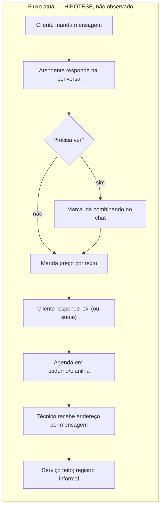
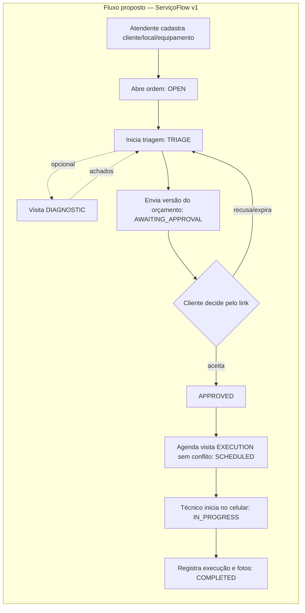

# Produto — ServiçoFlow

> Recorte de produto da fase 0. **Não validado com usuários** (ver `docs/discovery.md`).
> Cada afirmação sobre o mercado é hipótese; as regras de negócio vêm do brief
> (`docs/project-brief.md`, seções 3–5) e são decisões de projeto, não fatos observados.

## 1. Hipótese de valor

Pequenas empresas de manutenção de ar-condicionado **podem** perder pedidos,
aprovações e histórico ao coordenar serviços por mensagens e planilhas (hipóteses H1, H2).

Proposta: um lugar único onde

- o **atendente** vê quais serviços aguardam ação;
- o **cliente** consulta e decide sobre um orçamento específico por link;
- o **técnico** sabe o que fazer e registra o trabalho pelo celular.

**Dor principal assumida:** perda de contexto entre pedido → orçamento → visita
(informação espalhada em conversas). A ordem de prioridade entre "aprovação" e
"agenda" depende da descoberta (H2 vs. H4).

## 2. Personas (hipotéticas)

| Persona | Contexto assumido | Objetivo | Restrição |
|---|---|---|---|
| **Administrador** (dono/sócio) | Também atende e às vezes executa | Saber o que está parado e quem faz o quê | Pouco tempo para configurar ferramentas |
| **Atendente** | Recebe pedidos por telefone/mensagem | Registrar rápido, enviar orçamento, marcar visita sem conflito | Interrupções constantes; usa desktop e celular |
| **Técnico** | Em campo, celular, conexão variável (H5) | Ver endereço/problema do dia; registrar o que fez | Mãos ocupadas; tela pequena; não deve ver valores por padrão |
| **Cliente final** | Pessoa ou pequeno comércio | Entender o preço e decidir | Não cria conta; pode abrir o link só uma vez |

## 3. Restrições do recorte (brief 1.2 e 4.2)

- Uma ordem = um equipamento; uma visita = um técnico.
- Sem pagamentos, emissão fiscal, estoque, WhatsApp, offline, app nativo.
- Entrada de empresas por convite; sem cadastro público.
- Pedido é registrado pelo atendente (sem formulário público no MVP).
- Diagnóstico é cobrado fora do sistema.
- Aceite do orçamento é decisão operacional, não pagamento nem assinatura com validade jurídica.

## 4. Fluxo atual (hipotético) × fluxo proposto

Cancelamento é possível em qualquer estado não terminal, com motivo (brief 5.1).

## 5. Exemplo realista de ponta a ponta (dados sintéticos)

Empresa sintética **"Clima Norte Manutenção"** (fuso `America/Sao_Paulo`): 1 administradora,
1 atendente, 2 técnicos.

| # | Quem | O que faz | Estado da ordem |
|---|---|---|---|
| 1 | Administradora | Empresa já criada por fluxo controlado; convida atendente e técnicos | — |
| 2 | Atendente | Recebe ligação: "split da sala não gela e pinga água". Cadastra cliente "Padaria Exemplo (fictícia)", endereço e equipamento (split 12.000 BTU) | — |
| 3 | Atendente | Abre a ordem **#0042** com a descrição | `OPEN` |
| 4 | Atendente | Assume e inicia triagem | `TRIAGE` |
| 5 | Atendente | Agenda visita de **diagnóstico** com Técnico 1, ter 09:00–10:00 | `TRIAGE` (diagnóstico não muda para `SCHEDULED`) |
| 6 | Técnico 1 | No celular, inicia e conclui o diagnóstico: "dreno obstruído + baixa carga de gás"; 2 fotos | `TRIAGE` |
| 7 | Atendente | Monta orçamento v1: limpeza de dreno R$ 180,00; recarga de gás R$ 350,00; desconto R$ 30,00 → **total R$ 500,00** (centavos: 50000). Validade 7 dias. Envia | `AWAITING_APPROVAL` |
| 8 | Cliente | Abre o link (GET não decide), confere itens e clica em **Aceitar** + confirma | `APPROVED` |
| 9 | Atendente | Agenda **execução** com Técnico 2, qui 14:00–16:00. Tentativa de 15:00–17:00 com o mesmo técnico em outra ordem recebe conflito | `SCHEDULED` |
| 10 | Técnico 2 | Inicia a visita no local | `IN_PROGRESS` |
| 11 | Técnico 2 | Registra o resumo de execução e fotos; conclui | `COMPLETED` |
| 12 | Administradora | Vê a linha do tempo completa e a ordem fora das pendências | `COMPLETED` |

Variante: se no passo 8 o cliente pedisse para tirar a recarga, a atendente **revisa**:
v1 é invalidada, o link de v1 é revogado e uma v2 é enviada (brief 5.1/5.2).

## 6. Conjunto mínimo do piloto (Marco A)

Em ordem de dependência:

1. Identidade, empresa, convite, papéis e isolamento (base de segurança).
2. Cliente, endereço, equipamento; abrir ordem; triagem; linha do tempo.
3. Orçamento com itens, versões, envio, link privado e decisão.
4. Visitas de diagnóstico e execução sem sobreposição.
5. Área do técnico: iniciar/concluir, resumo e fotos privadas.
6. Notificação por e-mail via outbox (envio do link e confirmação).
7. Painel de pendências mínimo.

Se a descoberta mostrar que **H4 (conflito de agenda) é falsa**, a agenda fica como lista
simples — mas a constraint de não sobreposição permanece, por ser barata e proteger dados.

## 7. Métricas (definições do brief 3.5)

Definidas antes de instrumentar; sem linha de base ainda. Ver `docs/discovery.md` §7.
Metas não são resultados.

## 8. Pendências explícitas do responsável

| Item | Estado |
|---|---|
| Orçamento mensal para infraestrutura | **Não informado** — necessário antes da fase 10 |
| Horas disponíveis por semana | **Não informado** — o brief usa 15 h/semana como referência (12–20 semanas) |
| Empresa parceira para piloto | **Não identificada** — projeto segue como demonstração técnica |
| Stack: manter TypeScript/Next.js/NestJS? | Assumido **sim** (brief §2); mudar exige registro antes da fase 1 |
| Domínio e conta de hospedagem | Não necessários até a fase 10 |

## 9. Resultado esperado por marco

| Marco | Resultado esperado | Condição de "feito" |
|---|---|---|
| **A — Piloto funcional** | Fluxo da seção 5 executável de ponta a ponta com persistência real, no celular e no desktop | Checklist brief 15.1; jornada percorrida por outra pessoa |
| **B — V1 em produção** | Mesmo fluxo em HTTPS, com isolamento e concorrência testados, outbox recuperável, backup restaurado, runbooks | Checklist brief 15.2; evidências em `docs/evidence/` |
| **C — IA avaliada** | Sugestão de triagem comparada a um baseline por regras; lançada só se passar no gate | Checklist brief 15.3 (opcional) |
